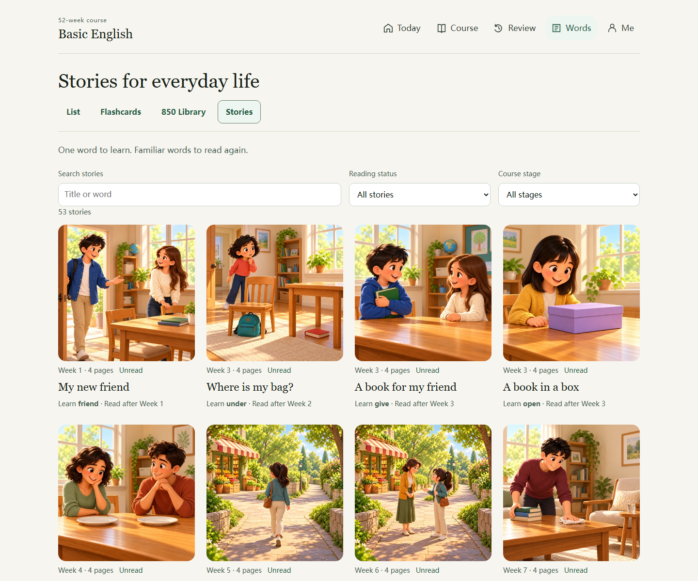
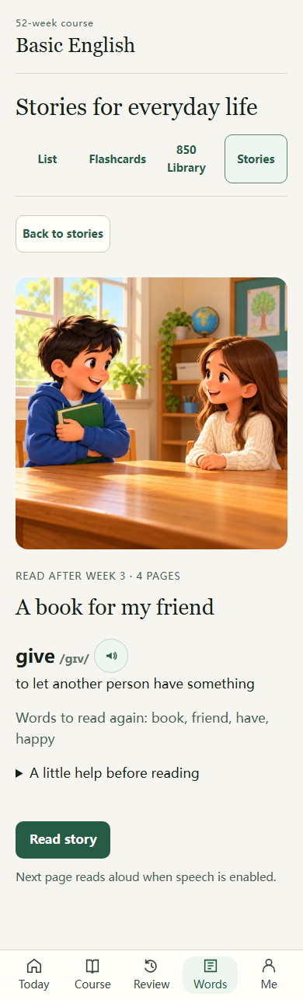
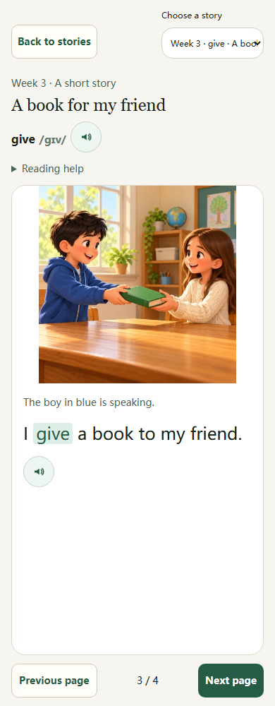
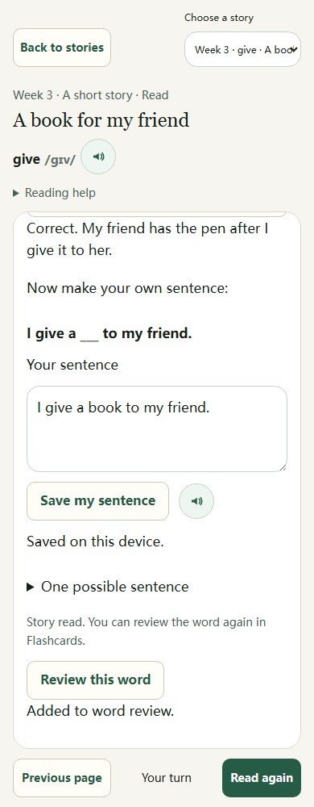
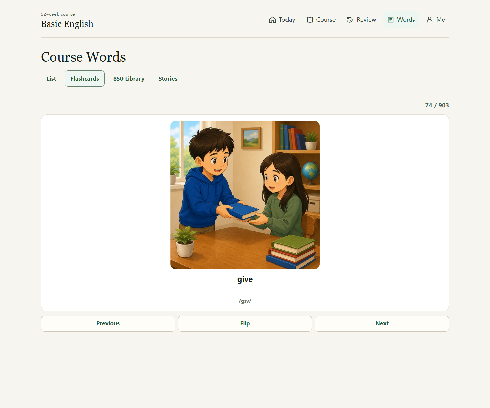
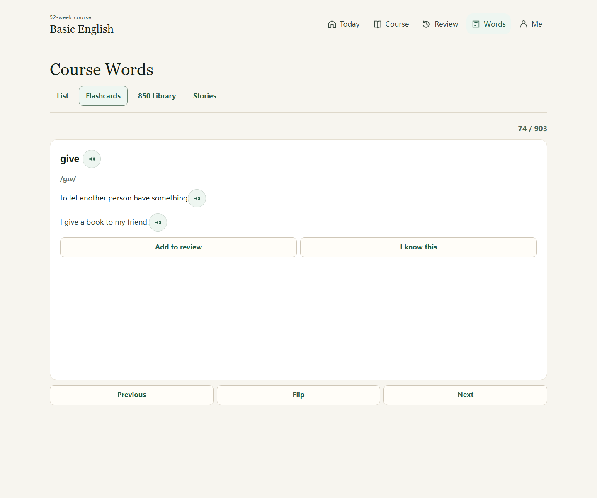
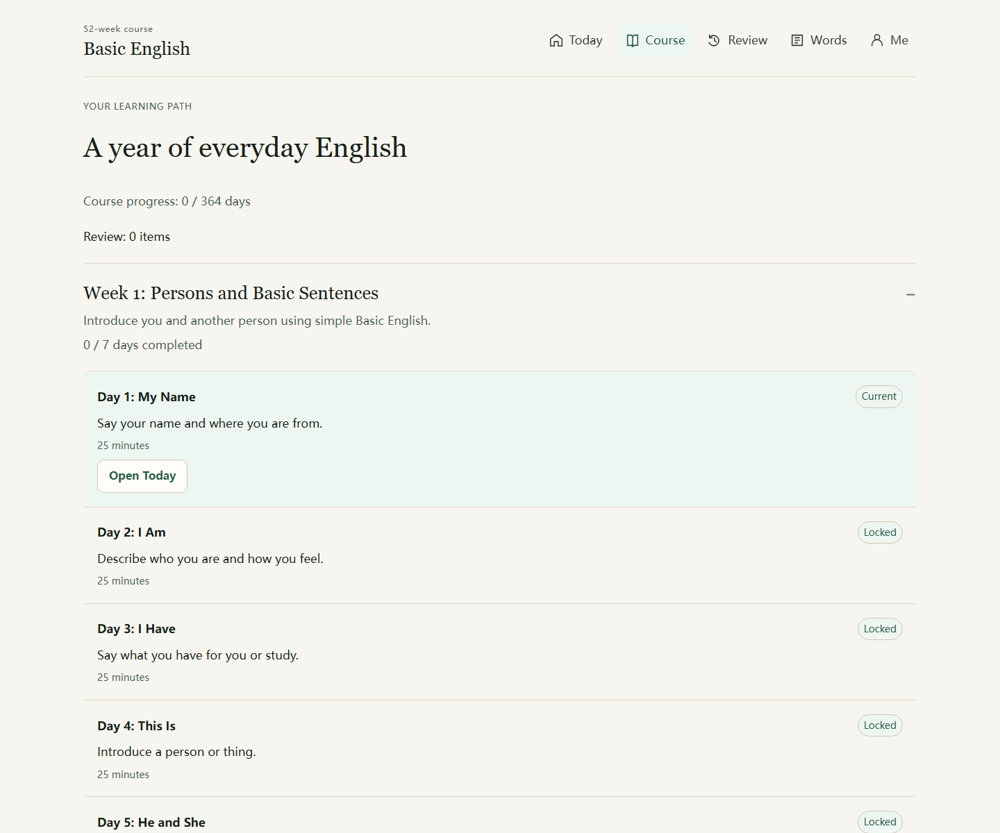
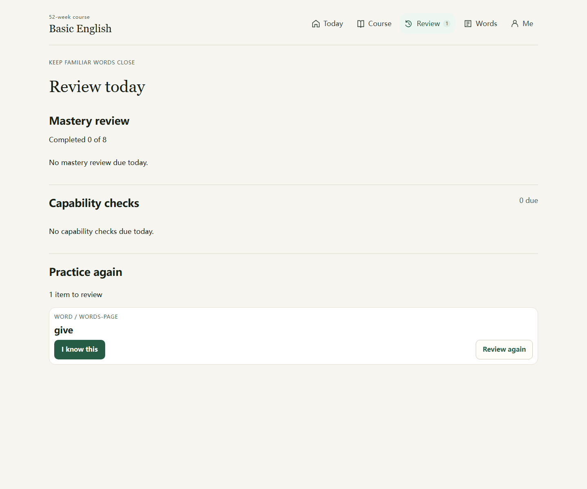

# Basic English 52 Weeks

[](https://github.com/AndsGo/basic_english/actions/workflows/deploy-github-pages.yml)

A browser-based Basic English learning application for building the ability to describe daily life and express simple ideas. It uses C. K. Ogden's Basic English 850 words as its foundation, then teaches them through everyday situations, reusable sentence patterns, listening, speaking, reading, and writing practice.

**Try it:** [andsgo.github.io/basic_english](https://andsgo.github.io/basic_english/)

[中文说明](README_zh.md) · [Releases](https://github.com/AndsGo/basic_english/releases) · [Story curriculum](docs/storybooks/README.md)

Learn one word through a little everyday story, then use it in your own sentence. The app combines a structured 52-week course with 53 illustrated books, an 850-word library, and scheduled review.


*Product concept illustration. The application screenshots below show the actual interface.*

## Learning goal

By completing the course, learners should be able to use a small, practical English vocabulary to:

- describe people, objects, places, routines, needs, feelings, and problems;
- handle common daily situations such as introductions, home life, food, transport, shopping, work, and health;
- understand and produce short, clear English sentences; and
- give simple reasons, preferences, plans, and opinions.

The course is designed around meaningful output, not isolated word memorization. The app contains a small number of product-approved supplementary forms where they are needed for usable beginner language; the canonical Ogden vocabulary is kept and validated separately.


These are examples of what you practice, rather than a promise of automatic fluency. You build the ability through lessons, personal expression, and repeated review.

## What is included

- **52-week course path** with daily lessons and scenario-based goals.
- **Course words** with English definitions, IPA pronunciation, examples, optional Chinese help, and 512 x 512 visual flashcards.
- **Four Words modes:** course list, flip flashcards, an 850-word library, and Stories.
- **53 illustrated storybooks, 212 reading pages:** one target word sense per story, with 3–5 review words, a meaning check, and a personal sentence task.
- **Focused reading:** a before-reading introduction, automatic next-page narration when speech is enabled, optional Chinese help, and saved reading position.
- **Patterns and output tasks** for turning vocabulary into usable sentences.
- **Today flow** that guides the learner through the next practical lesson.
- **Review and mastery scheduling** for words, scenes, and learned capabilities.
- **Picture description and scene remix** activities for daily-life expression.
- **Listening and speaking pilot:** browser speech playback, microphone recording, playback, and self-checks.
- **Personal learning view** with progress, saved story sentences, language-help, voice, playback-rate, and theme settings.
- **Responsive reading space:** warm-white and forest-green styling, coordinated light/dark themes, desktop top navigation, and five labeled mobile navigation items.

## How to learn with it

1. Open **Today** and complete the next lesson in order.
2. Listen first, then read aloud and reuse the sentence patterns with your own information.
3. Use **Words** flashcards to connect a word with its image, pronunciation, English definition, and example.
4. Finish the output activity by speaking or writing about your actual day.
5. Return to **Review** daily. Review items are scheduled from completed learning and mastery practice.

Chinese help is optional. Leave it off for an English-first environment, and enable it only when clarification is needed.

### Find your way around

| Page | What to do |
| --- | --- |
| **Today** | Follow Review → Learn → Practice → Use it. Expand **Lesson steps** for the detailed sequence; complete the current requirements to continue. |
| **Course** | Browse the 52 weeks, open a week to see its days, and use **Open Today** on the current lesson. Later weeks show their actual unlock requirements. |
| **Review** | Complete due mastery, capability, and practice items. |
| **Words** | Choose **List**, **Flashcards**, **850 Library**, or **Stories**. |
| **Me** | View learning progress and saved story sentences; set Chinese help, speech, voice speed, accent, and theme. |

[See a complete Today task](docs/product/screenshots/01-today-desktop.png). The first lesson practices introducing yourself through listening, a short answer, and a meaning check.

### Learn with a story



1. Open **Words → Stories**. Search by title or target word, or filter by reading status and course stage. The suggested reading week helps you choose; it does not lock the book.
2. Select a cover. Read the target meaning and review words, then choose **Read story** or **Continue reading**.
3. Move through the four pages. **Next page** automatically reads the new English text when speech is enabled. Use the playback control to listen again; long explanations scroll within the reading area.
4. Choose **Finish story**, answer the meaning question, and write your own sentence. Select **Save my sentence** to keep it on this device and find it later in **Me**. **Review this word** separately adds the word to review.

<table>
  <tr>
    <th>1. Before reading</th>
    <th>2. Read in context</th>
    <th>3. Save your sentence</th>
  </tr>
  <tr>
    <td valign="top"></td>
    <td valign="top"></td>
    <td valign="top"></td>
  </tr>
</table>

The three screens follow the same story in the same light-theme, English-first session. The last screen is scrolled to the saved sentence and review confirmation; [the desktop practice screen shows the whole meaning check and expression task](docs/product/screenshots/10-give-practice-desktop.png).

Reading status, comprehension answers, saved sentences, and word mastery are separate records. Finishing a book does not automatically mark its word known or complete a course day. The 53 books supplement the 850-word course; they do not individually teach all 850 words. See the [curriculum and coverage notes](docs/storybooks/README.md).

### Practice with flashcards

Open **Words → Flashcards** to see the illustration, word, and IPA. Select **Flip** for the meaning, example, and playback controls, then choose **I know this** or **Add to review**. Use **850 Library** to search the complete core-word list.

<table>
  <tr><th>Connect the word with an action</th><th>Flip for meaning, example, and playback</th></tr>
  <tr>
    <td></td>
    <td></td>
  </tr>
</table>

<details>
<summary>Continue the same session: course, review, saved expression, and dark theme</summary>

**Course:** expand a week to view its goals, day states, and current lesson.



**Review:** the word **give** appears after selecting **Review this word** in the story.



**Me:** the same saved sentence is available under **My story sentences**. Course-day completion remains independent of story reading.


[Desktop reader](docs/product/screenshots/09-give-reader-desktop.png) · [Same page in dark theme](docs/product/screenshots/14-give-reader-desktop-dark.png) · [Dark mobile reader](docs/product/screenshots/15-give-reader-mobile-dark.png) · [Complete screenshot sequence and capture details](docs/product/README.md)

</details>

All application screenshots were freshly captured from one isolated browser session, using real UI actions rather than test-output images or progress fixtures. The concept illustrations explain the product; they are not screenshots. The personal sentence is demonstration input, and your own records stay on your device.

## Technology

- React 19
- TypeScript
- Vite
- IndexedDB via `idb` for on-device learning progress and recordings
- Web Speech API for text-to-speech
- MediaRecorder API for local speaking recordings
- Vitest and Testing Library for unit and component tests
- Playwright for end-to-end tests
- GitHub Actions and GitHub Pages for deployment

## Run locally

### Prerequisites

- Node.js 22 or later
- npm
- For image conversion only: `ffmpeg` with `libwebp` support

```bash
git clone https://github.com/AndsGo/basic_english.git
cd basic_english
npm ci
npm run dev
```

Vite prints the local URL in the terminal. The production build uses `/basic_english/` as its base path so that it works on GitHub Pages.

## Scripts

| Command | Purpose |
| --- | --- |
| `npm run dev` | Start the local Vite development server. |
| `npm run build` | Type-check and create a production build in `dist/`. |
| `npm test` | Run the Vitest unit and component suite. |
| `npm run test:e2e` | Run the Playwright end-to-end suite. |
| `npm run content:health` | Generate the course content health report. |
| `npm run stories:build` | Build the story catalog and supporting curriculum reports. |
| `npm run stories:audit` | Audit story content, coverage, and referenced artwork. |
| `npm run assets:webp` | Convert PNG learning assets to WebP at quality 90. |

The WebP converter also supports `--dry-run`, `--overwrite`, and `--quality <1-100>`. For example:

```bash
npm run assets:webp -- --dry-run
npm run assets:webp -- --quality 85 --overwrite
```

## Data and browser support

Learning progress, story reading positions, comprehension answers, saved sentences, settings, and saved recordings stay in the browser's local storage and IndexedDB. They are not sent to an application server or synchronized between devices. Clearing browser site data will reset these local records.

Speech playback depends on the voices installed in the learner's browser or operating system. Speaking practice requires a browser that supports microphone access and `MediaRecorder`; microphone permission is requested only when the learner starts a recording.

## Content and asset standards

- The canonical Basic English vocabulary is defined in [src/content/basicEnglish850.ts](src/content/basicEnglish850.ts).
- Course composition is assembled in [src/content/course.ts](src/content/course.ts).
- Content validation lives in [src/content/validateContent.test.ts](src/content/validateContent.test.ts).
- Image creation and replacement rules are maintained in [AGENTS.md](AGENTS.md). Word and scene images must preserve their intended meaning and follow the project's 512 x 512 polished-cartoon visual standard.
- [DESIGN.md](DESIGN.md) defines the authoritative page design standard. See the [product guide and current screenshots](docs/product/README.md) and [storybook curriculum](docs/storybooks/README.md) for the learning flow, teaching structure, and coverage.

Supporting product, content, and implementation documents are in [docs](docs).

## Deployment

Every push to `main` runs the [GitHub Pages workflow](.github/workflows/deploy-github-pages.yml): it installs dependencies, builds the app, and deploys `dist/` to GitHub Pages.

## License

This project is available under the [MIT License](LICENSE).
