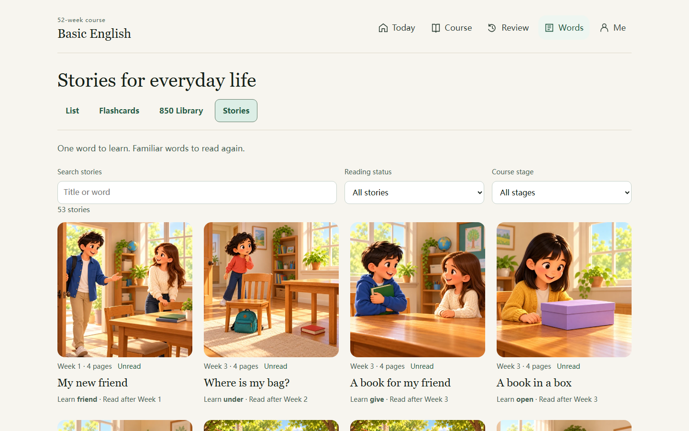
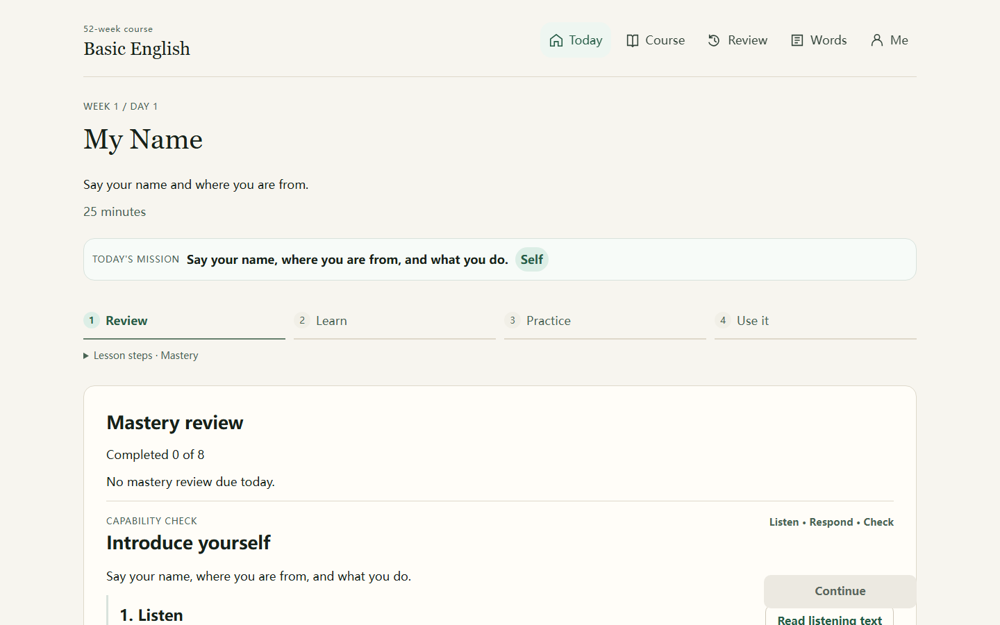
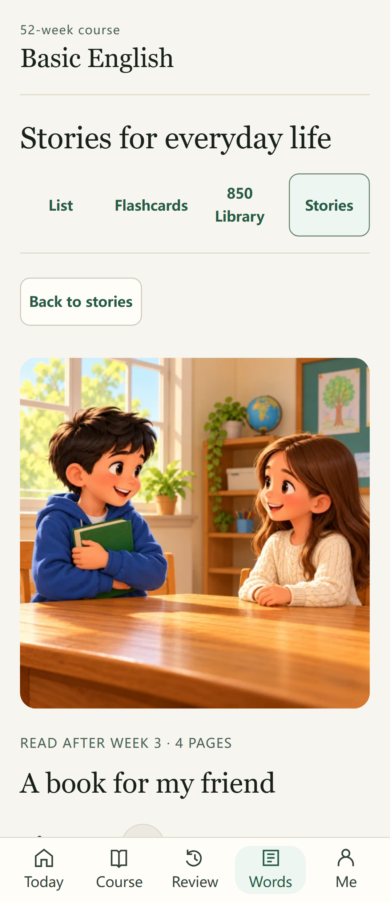
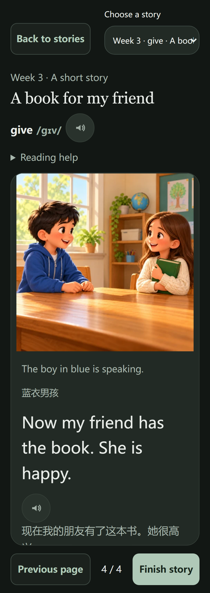
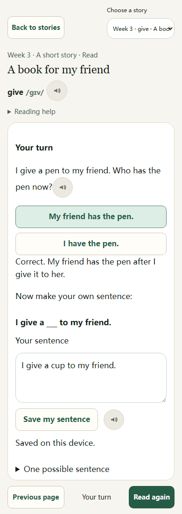
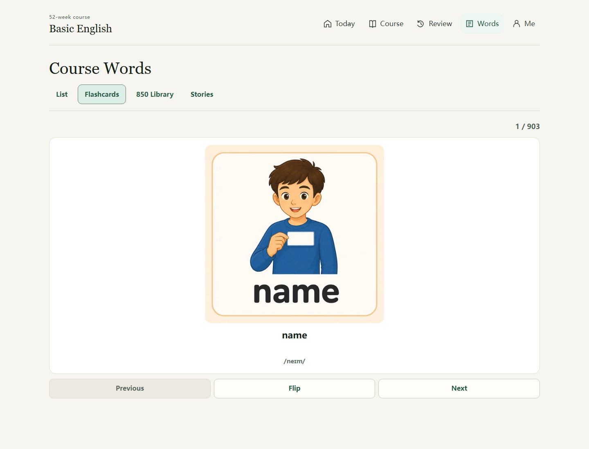
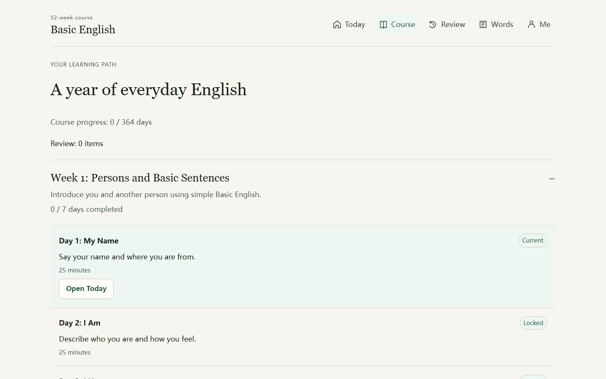
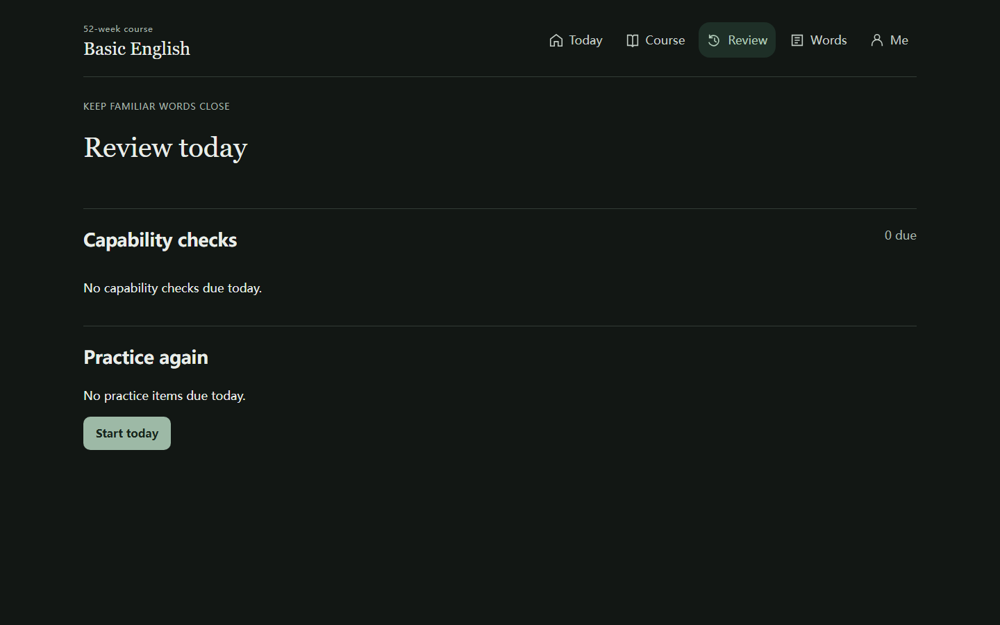

# Basic English 52 周学习应用

[](https://github.com/AndsGo/basic_english/actions/workflows/deploy-github-pages.yml)

一个在浏览器中运行的 Basic English 英语学习应用。它以 C. K. Ogden 的 Basic English 850 词为基础，通过生活场景、可复用句型、听说读写练习，帮助学习者描述日常生活并表达简单想法。

**在线体验：**[andsgo.github.io/basic_english](https://andsgo.github.io/basic_english/)

[English README](README.md)

在一个生活小故事里学一个词，再用这个词说一句自己的话。应用将 52 周课程、53 本场景绘本、850 词库与到期复习结合起来。



## 学习目标

完成课程后，学习者可以用一组有限但实用的英语词汇：

- 描述人物、物品、地点、日常习惯、需求、感受和问题；
- 应对自我介绍、居家生活、饮食、交通、购物、工作和健康等常见生活场景；
- 理解并说出简短、清楚的英语句子；
- 表达简单的原因、偏好、计划和看法。

课程重视真实输出，而不是孤立背诵单词。为了让初学者能说出自然可用的句子，课程会使用少量经过产品确认的补充形式；Ogden Basic English 核心词表会被单独维护和验证。

## 主要内容

- **52 周课程路径**：包含每日学习内容和场景化目标。
- **课程单词**：提供英文释义、国际音标、例句、可选中文帮助和 512 x 512 图片闪卡。
- **四种单词学习模式**：课程列表、翻转闪卡、850 词库和 Stories 绘本。
- **53 本绘本、212 页正文**：每篇重点学习一个词义，顺带复习 3–5 个词，读后完成理解题和自己的表达。
- **专注阅读**：读前介绍、开启语音时下一页自动朗读、可选中文帮助，以及阅读位置恢复。
- **句型与输出任务**：把认识的单词转化为可使用的句子。
- **Today 学习流程**：引导学习者完成下一节实用课程。
- **复习与掌握度系统**：安排单词、场景和能力点复习。
- **看图描述与场景重组**：训练在生活场景中组织英语表达。
- **听说练习试点**：浏览器朗读、录音、录音回放和自我检查。
- **个人学习页**：查看学习进度和保存的绘本句子，设置中文帮助、语音、播放速度、口音和主题。
- **适配桌面与手机**：暖白与深绿的阅读界面、协调的深浅主题、桌面顶部导航和手机底部五项导航。

## 推荐学习方式

1. 打开 **Today**，按顺序完成当天课程。
2. 先听句子，再跟读，并用自己的信息替换句型中的内容。
3. 使用 **Words** 中的闪卡，把单词和图片、音标、英文释义、例句建立联系。
4. 完成输出任务，用英语说或写当天真实发生的事情。
5. 每天回到 **Review** 完成到期复习。

中文帮助默认是可选项。建议在英语优先的学习环境中保持关闭，只在需要澄清含义时打开。

### 五个页面怎么用

| 页面 | 使用方式 |
| --- | --- |
| **Today** | 按 Review → Learn → Practice → Use it 完成当日学习。展开 **Lesson steps** 查看细步骤；完成当前要求后继续。 |
| **Course** | 浏览 52 周路径，展开一周查看每天的任务；点击当前课程的 **Open Today** 开始学习。后续周次会显示真实解锁条件。 |
| **Review** | 完成到期的掌握度复习、能力检查和待练习项目。 |
| **Words** | 切换 **List** 列表、**Flashcards** 闪卡、**850 Library** 词库或 **Stories** 绘本。 |
| **Me** | 查看学习记录与已保存的绘本句子，调整中文帮助、语音、语速、口音和主题。 |



### 用绘本学习一个词

1. 打开 **Words → Stories**，按书名或重点词搜索，也可按阅读状态、课程阶段筛选。建议阅读周次用于选书，不会额外锁定绘本。
2. 点击封面，在读前页查看目标词义和复习词，再点击 **Read story** 开始，或通过 **Continue reading** 接着上次的位置阅读。
3. 阅读四页生活小故事。开启语音时，点击 **Next page** 会自动朗读新一页英文；也可点击播放按钮重听。较长解释可以在正文区内滚动查看。
4. 点击 **Finish story**，完成理解题，再写一句自己的表达。点击 **Save my sentence** 保存到本机，之后可在 **Me** 查看；需要复习目标词时，单独点击 **Review this word**。

<table>
  <tr>
    <th>1. 读前了解</th>
    <th>2. 场景中阅读</th>
    <th>3. 用词表达</th>
  </tr>
  <tr>
    <td valign="top"></td>
    <td valign="top"></td>
    <td valign="top"></td>
  </tr>
</table>

已读、理解题、保存句子和单词掌握状态分别记录。读完绘本不会自动将单词标为已掌握，也不会自动完成课程日。53 本绘本是 850 词课程的补充，并不表示每个核心词都有一篇独立绘本；详见[绘本课程与覆盖说明](docs/storybooks/README.md)。

### 用闪卡复习单词

打开 **Words → Flashcards** 查看插画、单词和音标；点击 **Flip** 查看释义和例句，并使用播放按钮听发音，再选择 **I know this** 标记已认识，或 **Add to review** 加入复习。**850 Library** 可以搜索完整核心词表。



<details>
<summary>更多使用截图：课程、复习与手机设置</summary>

**Course 课程目录：**展开周次，查看目标、日次状态与当前课程。



**Review 深色主题：**集中查看到期的掌握度复习、能力检查和待练习项目。



[手机绘本书架](docs/design/implementation/stories-mobile-dark.png) · [手机个人学习页](docs/design/implementation/me-mobile-dark.png) · [主题控件对照](docs/design/theme-review/README.md) · [完整页面截图](docs/design/implementation/README.md)

</details>

以上截图来自实际应用。练习截图中的句子是演示输入；你自己的学习进度和保存的表达只保存在当前设备。

## 技术栈

- React 19
- TypeScript
- Vite
- `idb` 和 IndexedDB：在设备本地保存学习进度和录音
- Web Speech API：文本朗读
- MediaRecorder API：本地口语录音
- Vitest 与 Testing Library：单元和组件测试
- Playwright：端到端测试
- GitHub Actions 与 GitHub Pages：构建和部署

## 本地运行

### 前置条件

- Node.js 22 或更高版本
- npm
- 仅图片转换需要：带 `libwebp` 支持的 `ffmpeg`

```bash
git clone https://github.com/AndsGo/basic_english.git
cd basic_english
npm ci
npm run dev
```

Vite 会在终端显示本地访问地址。生产构建使用 `/basic_english/` 作为基础路径，以便部署到 GitHub Pages。

## 常用命令

| 命令 | 用途 |
| --- | --- |
| `npm run dev` | 启动本地 Vite 开发服务器。 |
| `npm run build` | 类型检查并在 `dist/` 中生成生产构建。 |
| `npm test` | 运行 Vitest 单元与组件测试。 |
| `npm run test:e2e` | 运行 Playwright 端到端测试。 |
| `npm run content:health` | 生成课程内容健康检查报告。 |
| `npm run stories:build` | 构建绘本目录与配套课程报告。 |
| `npm run stories:audit` | 检查绘本内容、词汇覆盖和插画引用。 |
| `npm run assets:webp` | 以质量 90 将 PNG 学习素材转换为 WebP。 |

WebP 转换脚本支持 `--dry-run`、`--overwrite` 和 `--quality <1-100>` 参数，例如：

```bash
npm run assets:webp -- --dry-run
npm run assets:webp -- --quality 85 --overwrite
```

## 数据与浏览器支持

学习进度、绘本阅读位置、理解题答案、保存的句子、设置和录音只保存在浏览器的本地存储和 IndexedDB 中，不会发送到应用服务器，也不会自动跨设备同步。清除网站数据会删除这些本地记录。

朗读功能依赖浏览器或操作系统安装的语音。口语练习需要浏览器支持麦克风权限和 `MediaRecorder`；只有学习者主动开始录音时才会请求麦克风权限。

## 内容与图片规范

- Ogden Basic English 核心词表定义在 [src/content/basicEnglish850.ts](src/content/basicEnglish850.ts)。
- 课程内容在 [src/content/course.ts](src/content/course.ts) 中组装。
- 内容验证位于 [src/content/validateContent.test.ts](src/content/validateContent.test.ts)。
- 图片生成和替换规则见 [AGENTS.md](AGENTS.md)。单词与场景图片必须准确表达预期语义，并遵循项目的 512 x 512 精致卡通视觉标准。
- [DESIGN.md](DESIGN.md) 是统一页面设计规范；[页面改造记录](docs/design/implementation/README.md)和[绘本课程设计](docs/storybooks/README.md)提供实际截图、教学结构与词汇覆盖说明。

产品、内容与实现文档位于 [docs](docs) 目录。

## 部署

每次推送到 `main` 都会运行 [GitHub Pages 工作流](.github/workflows/deploy-github-pages.yml)：安装依赖、构建应用，并将 `dist/` 部署到 GitHub Pages。

## 许可证

本项目采用 [MIT License](LICENSE)。
