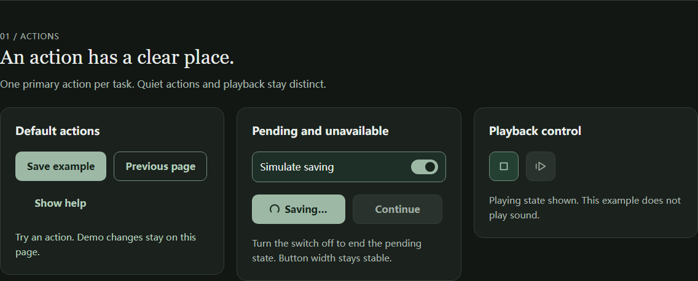

# 基础组件与应用接入

依据 [DESIGN.md](../../../DESIGN.md) 1.2，建立可交互的 React 组件展示页作为审阅基准，并接入设置、自查、学习、复习、绘本及词库页面。基础组件设计已于 2026-10-29 确认并纳入规范第 15、18、19 节。

## 打开展示页

启动 `npm run dev`，在终端给出的应用地址后加上 `?view=components`，例如：

```text
http://localhost:5173/basic_english/?view=components
```

这也是生产构建支持的独立展示入口，通过动态导入加载，不加入五个主导航。展示页不挂载 App，不创建学习仓库；主题、中文示例、填写内容和答案演示仅保存在本页内存中。离开后继续使用应用原有设置，不覆盖课程进度、语音或中文帮助偏好。

## 本轮交付

| 组件 | 实现与示例 |
| --- | --- |
| Button | primary、secondary、quiet；默认、禁用、加载。默认 type=button；加载时禁用重复激活、设置 aria-busy、保留按钮宽度。 |
| AnswerOption | 呈现选中、正确、重试与锁定；显式激活，评分与保存由页面负责。 |
| IconButton | 可访问名称、播放/停止演示、禁用；48px 触摸区域。 |
| Checkbox | 原生 checkbox 语义；整行点击、长标签、辅助说明、选中和禁用后保留勾选标记。 |
| RadioGroup | 原生同名 radio 分组；每组默认生成独立 name；方向键选择、单个和整组禁用。 |
| Switch | 原生 checkbox 与 switch 语义；稳定标签、即时开关及禁用演示。 |
| TextField | text/search、标签、说明、错误、只读、禁用。 |
| TextArea | 多行文字、说明、禁用和用户输入；不自动清除内容。 |
| Select | 统一页面内样式，保留原生选择器；包含禁用示例。 |
| FormField / FieldGroup | 关联 label、legend、hint、error 和控件；统一 aria-describedby 与错误状态。 |

源码位于 [src/components/ui](../../../src/components/ui)。Button、字段和选择控件按家族组织文件，没有引入新依赖。正式应用通过 main.tsx 加载 `ui/ui.css`，展示页使用相同样式。

### 学习状态只作视觉审阅

展示页包含显式答案按钮、选中、正确且锁定、重试提示等示例，帮助区分“选中”与“答对”。答案激活次数仅用于演示键盘行为，没有调用评分、复习调度或存储。实际题目使用同一 AnswerOption，评分、保存及重试继续由原页面控制。

## 状态与无障碍约定

- 所有颜色消费现有语义 token，不增加第二套品牌色。选中、播放和主操作分别表现；深色继续使用鼠尾草绿与深色主按钮文字。
- 选择标记约 20px；整行最小 48px 高。按钮、文本框和选择行使用 10px 圆角。
- 自定义选择标记旁保留真实 input，支持 label、焦点、Space、方向键和 disabled；不使用 display:none 隐藏输入。
- 焦点环为 3px、偏移 3px。高对比度模式显示原生选择标记与原生下拉箭头，减少动态效果时停用旋转动画。
- 输入标签不依赖 placeholder；错误和帮助通过 ID 与字段关联。只读字段可聚焦复制，禁用字段不可编辑。
- 单选组的选择回调不会触发答案按钮。未来迁移时，按钮“激活即提交”和 radio“改变当前选择”必须继续分开。
- 演示中的正确锁定答案保留选中标记和文字反馈；重试通过明确文字表达，不靠红绿判断。

## 使用示例

```tsx
import { Checkbox, RadioGroup } from './ui/SelectionControls';
import { TextArea } from './ui/TextFields';
import './ui/ui.css';

<Checkbox
  label="I used the word in my own sentence."
  checked={checked}
  onChange={event => setChecked(event.target.checked)}
/>

<RadioGroup
  label="Voice speed"
  value={speed}
  onValueChange={setSpeed}
  options={[{ value: 'normal', label: 'Normal' }, { value: 'slow', label: 'Slow' }]}
/>

<TextArea label="Your sentence" value={sentence} onChange={event => setSentence(event.target.value)} />
```

这是受控状态的调用片段；具体保存、校验和课程完成条件仍由原页面负责。原生输入 props 与事件可用于字段及布尔控件，RadioGroup 使用字符串值回调。

## 实际展示截图

截图另在新浏览器会话中拍摄，未使用测试输出图片；该会话结束时 localStorage 仍为空。

| 画面 | 查看 |
| --- | --- |
| 全页组件 | [浅色桌面](screenshots/desktop-light.png) · [深色与中文示例](screenshots/desktop-dark.png) |
| 按钮与播放状态 | [深色：加载、禁用、播放中](screenshots/actions-dark.png) |
| 手机选择控件 | [390px 深色](screenshots/choices-mobile-dark.png) · [320px 长标签](screenshots/checkboxes-narrow-dark.png) |
| 高对比度 | [系统颜色与原生选择标记](screenshots/choices-high-contrast.png) |



## 验证结果与边界

- 49 个文件、597 项单元测试通过；新增 8 项组件契约测试检查标签、描述、开关、禁用、分组隔离、加载、图标名称、错误关联及锁定答案。
- 展示页 4 项浏览器用例通过，覆盖桌面与手机项目；12 组布局配置覆盖 1440/390/320px、深浅主题、中文示例开关。另检查 200% 文字和强制高对比度模式。
- 浏览器验证整行选择、Space、radio 方向键、答案仅在显式激活时计数、加载按钮宽度不变、错误可消除、下拉可切换，以及展示页不写入原有学习设置。
- 两种主题下，主要操作、禁用操作和只读输入的文字对比度至少 4.5:1，未选选择标记的边界与底色至少 3:1。对比度在主题过渡完成后读取。
- 全套 32 项桌面/手机浏览器回归通过，包含学习主流程、主题、页面布局、53 篇绘本与组件展示；生产构建通过。Today 测试等待异步场景列表出现，主题测试等待按钮颜色过渡稳定后再测量。
- 当前浏览器验证使用 Chromium；Safari 与真实读屏器体验仍待下一轮验收。

## 正式应用接入范围

- Me：中文与朗读开关、语速、口音、主题选择，沿用原设置持久化。
- 自查与能力检查：Checkbox、RadioGroup、TextArea 与保存中的 Button；单选浏览不会提交结果。
- 学习、掌握度复习、强化与绘本：AnswerOption 保持显式按钮激活，锁定后保留选择与文字反馈。
- 造句、翻译、描述、搜索、筛选：统一 TextField、TextArea、Select，保留已有事件与完成条件。
- 页面操作与播放：共享 Button / IconButton；主导航与绘本封面继续使用专用布局。

基础组件不导入学习仓库、语音或评分服务。被替代的旧控件样式已移除，布局类继续由页面维护。下列截图通过独立浏览器会话实际操作拍摄，未复用测试截图。

| 实际页面 | 新截图 |
| --- | --- |
| 深色设置 | [开关与单选组](screenshots/app-settings-dark.png) |
| Today | [浅色能力检查](screenshots/app-today-light.png) |
| 320px 绘本筛选 | [搜索、下拉与封面](screenshots/app-story-filters-320.png) |
