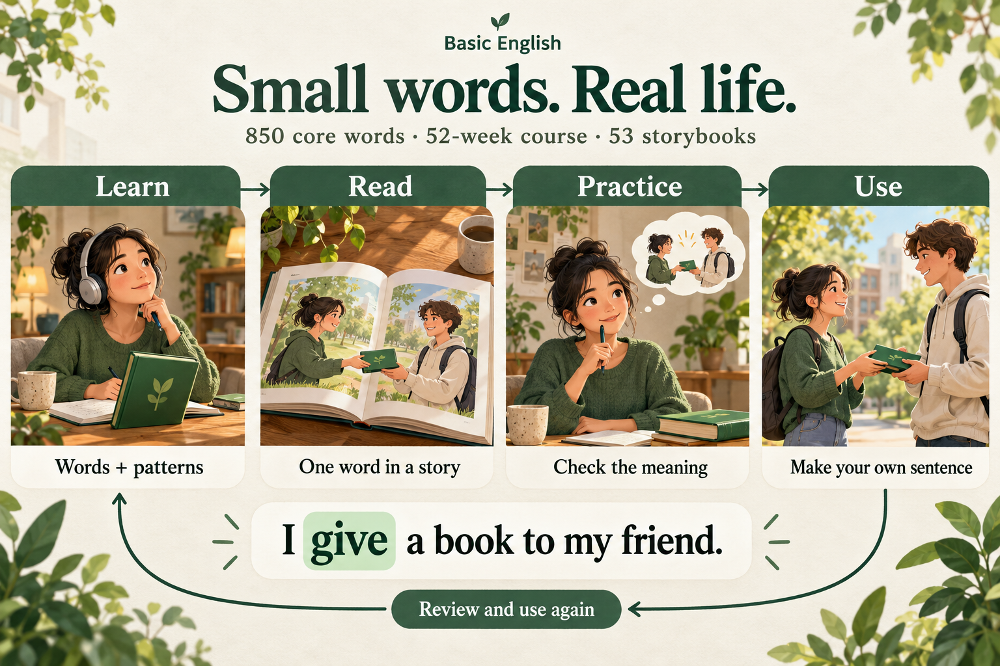
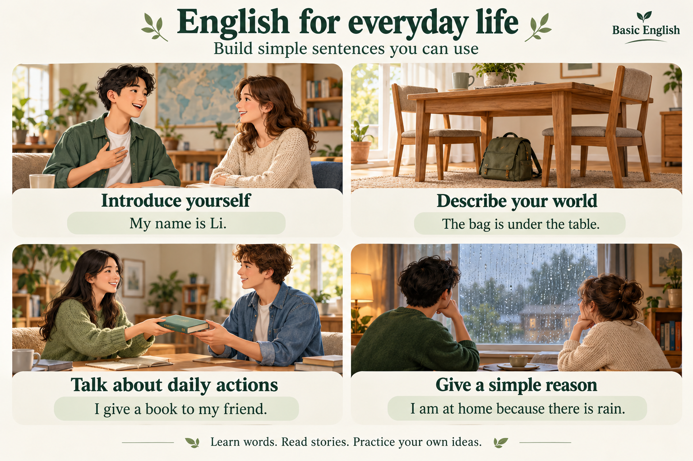
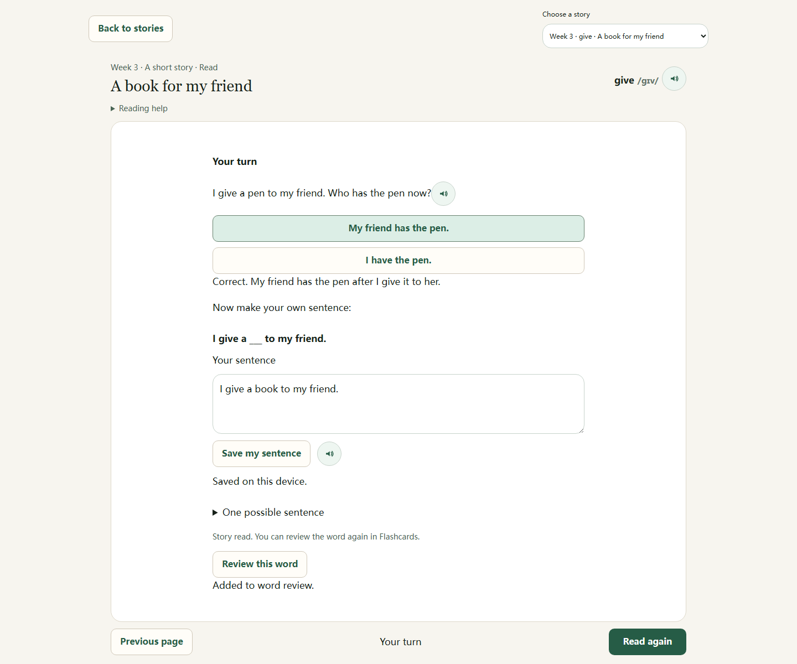
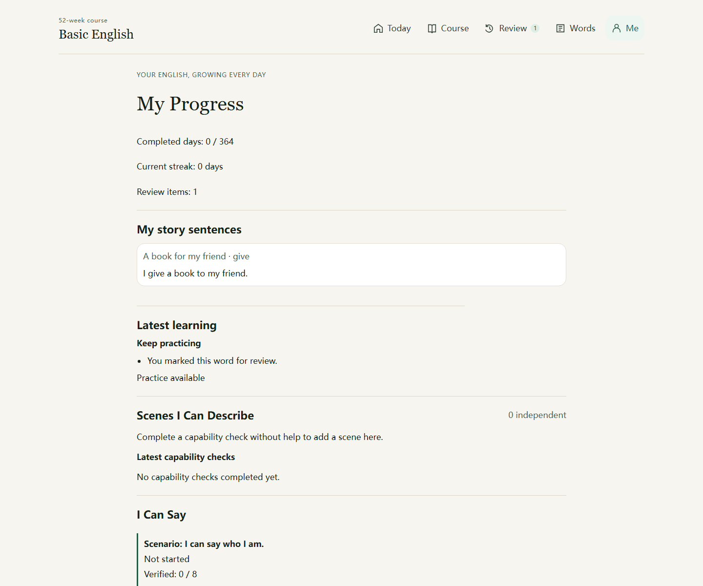

# 产品理念与实际使用截图

这套素材用于帮助初次访问项目的人快速了解：应用如何帮助学习，以及可以练习哪些日常英语表达。

## 两张理念图

两张图使用内置 **image_gen.imagegen** 生成，保存于本目录的 `concepts/`。它们是产品说明插画，不是应用界面，也不是替换课程学习图片。准确提示词保存在 [prompts.json](concepts/prompts.json)。

### 如何学习：把一个词变成自己的表达



Learn → Read → Practice → Use，配合 Review and use again。示例始终围绕 **give** 和 **I give a book to my friend.**。这里概括的是学习方法；Today 的课程阶段名称仍为 Review、Learn、Practice、Use it。

### 学到什么：能够逐步表达的日常内容



| 表达目标 | 示例 |
| --- | --- |
| 介绍自己 | My name is Li. |
| 描述位置 | The bag is under the table. |
| 表达动作 | I give a book to my friend. |
| 说明原因 | I am at home because there is rain. |

这些是需要学习和练习的目标，不是学习效果保证。53 本绘本补充 850 词课程，并不意味着每个词都有一篇独立绘本，也不意味着读过就已掌握。

## 一次连贯的实际使用

所有界面均重新拍摄于当前应用，来源提交、时间、尺寸与逐图说明见 [capture-manifest.json](screenshots/capture-manifest.json)。未复用测试结果目录或旧设计验收图片。

主流程统一使用浅色主题、英文优先、开启朗读；桌面基础视口为 1440 × 1200，手机基础视口为 390 × 1000，设备像素比均为 1。拍摄长页时扩展实际视口高度，使固定导航停留在图片底部，避免普通全页截图把导航拍到内容中间；拍摄清单同时记录基础和实际视口。手机造句页明确滚动到保存结果。应用截图未改写 CSS、拼接界面、隐藏实际控件或填入虚构进度。

截图顺序是：新会话查看课程 → 查看 give 闪卡正反面 → 在书架选书 → 读前了解 → 阅读第 3 页 → 答题、保存句子、加入复习 → 查看 Review 与 Me → 切换深色，重新打开同一本书查看第 3 页。

| 顺序 | 实际画面 | 说明 |
| --- | --- | --- |
| 01 | [Today 完整任务](screenshots/01-today-desktop.png) | 第一天的听力、回答、自查和继续条件。 |
| 02 | [Course](screenshots/02-course-desktop.png) | 第一周展开，第一天为当前课程；没有虚构已完成天数。 |
| 03 | [give 闪卡正面](screenshots/03-give-flashcard-front.png) | 单词、音标与给出物品的动作。 |
| 04 | [同一闪卡背面](screenshots/04-give-flashcard-back.png) | 释义、例句、朗读与掌握/复习按钮。 |
| 05 | [绘本书架](screenshots/05-story-library-desktop.png) | 53 本真实绘本、建议周次、搜索与筛选。 |
| 06 | [读前介绍，桌面](screenshots/06-story-intro-desktop.png) | A book for my friend，目标词 give。 |
| 07 | [同一读前介绍，手机](screenshots/07-story-intro-mobile.png) | 同一故事、同一设置。 |
| 08 | [第 3 页，手机](screenshots/08-give-reader-mobile.png) | I give a book to my friend.，插画、朗读和翻页完整可见。 |
| 09 | [同一页，桌面](screenshots/09-give-reader-desktop.png) | 同一目标词和相同页码的桌面布局。 |
| 10 | [理解题与表达，桌面](screenshots/10-give-practice-desktop.png) | 理解题正确，保存同一句表达，并加入复习；任务内容完整可见。 |
| 11 | [保存表达，手机](screenshots/11-give-sentence-mobile.png) | 正文区向下滚动，查看已保存与已加入复习的提示。 |
| 12 | [Review](screenshots/12-review-desktop.png) | 刚才加入的 give 实际出现在复习队列。 |
| 13 | [Me 中的句子](screenshots/13-my-sentence-desktop.png) | 实际显示刚才保存的句子；课程进度与绘本独立。 |
| 14 | [重读同一页，深色桌面](screenshots/14-give-reader-desktop-dark.png) | 完成故事后重新打开第 3 页，因此带有 Read 状态。 |
| 15 | [重读同一页，深色手机](screenshots/15-give-reader-mobile-dark.png) | 与深色桌面保持同一内容、页码和记录状态。 |

### 读完后留下什么

保存的表达不是装饰数据，同一句话会进入 Me；加入复习的词会进入 Review。这两个动作都不会自动完成课程日。





## 重新拍摄

从仓库根目录启动本地开发服务，然后运行专用拍摄脚本：

```bash
npm run dev -- --port 5195 --strictPort
```

在另一个终端运行：

```bash
node scripts/capture-product-screenshots.cjs
```

脚本依赖项目现有的 Playwright，必要时先运行 `npx playwright install chromium`。它会更新本目录截图和拍摄清单；使用全新的隔离浏览器会话，不读写使用者平时浏览器里的学习数据。生成的例句与复习项目只存在于该隔离会话。`PRODUCT_CAPTURE_URL` 可指定另一个本地 Vite 地址；脚本通过只读课程模块定位 give 闪卡，不能直接用于生产静态站点。

本次检查包括图片实际加载、页面无横向溢出、桌面读后任务能在截图中完整显示，以及浏览器没有运行错误。此次改动仅包含说明文档、产品素材和拍摄脚本，没有改动应用学习逻辑。
